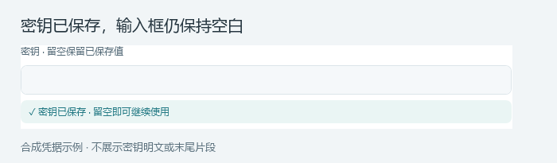
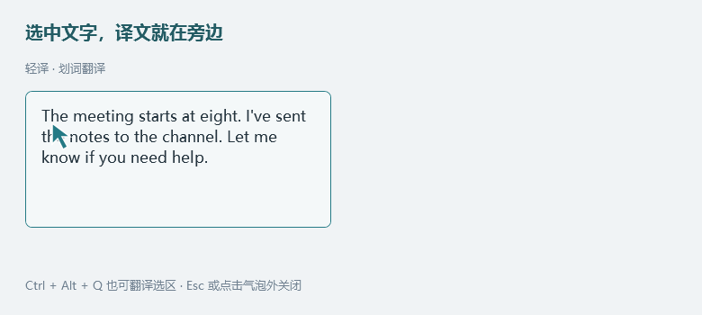

# 轻译 QuietTranslate


**选中文字，点一下「译」。** 译文浮在鼠标旁，用完即走。

Windows 上的轻量翻译工具：划词、截图 OCR、输入翻译，以及电脑声音实时翻译字幕。文字翻译不保存历史；语音字幕记录加密临时保留，关闭功能即删除。

**1.6.0 新增电脑声音实时字幕**：听 Discord、视频或游戏时，把声音译成悬浮字幕。支持播放设备或指定应用采集、目标语言切换、字体与透明度调整，以及关闭功能即删除的本次记录。语音功能默认关闭，需主动开启；划词按钮默认开启。

原文先到时可淡斜体预览，译文收到就显示为淡斜草稿，本地稳定后转为正体；最多三行，同段多行一起计时。原文、译文独立分段记录，不强行逐句配对。详见[实时字幕配置](docs/实时语音字幕.md)。

[**下载 Windows 轻量版**](https://github.com/QeeYu/QuietTranslate/releases/latest) · [完整使用说明](docs/使用说明.md) · [更新说明](更新说明.md) · [本机 OCR 教程](local-ocr/本机OCR教程.md)


## 随手翻译

| 你正在做什么 | 怎么用 |
|---|---|
| 读网页、聊天或文档 | 选中文字 → 点击附近的「译」按钮，或按 **Ctrl+Alt+Q** |
| 文字无法选中 | **Ctrl+Alt+W** → 框选图片文字 → OCR 识别并翻译 |
| 想自己输入一句话 | **Alt+T** 打开输入栏，停笔约 **800 毫秒**后自动翻译 |
| 听 Discord、视频或游戏声音 | 在「实时语音字幕」保存服务和音源，再用 **Ctrl+Alt+S** 开／关功能；关闭即删除本次记录 |

支持自动识别源语种，默认译为简体中文；输入栏可自行选择源语言和目标语言。全部快捷键均可修改。

## 几分钟开始使用

1. 安装 [.NET 8 Desktop Runtime x64](https://dotnet.microsoft.com/zh-cn/download/dotnet/8.0)。系统要求 **Windows 10 2004 / Windows 11 x64**。已有该运行环境可跳过。
2. 从 [Releases](https://github.com/QeeYu/QuietTranslate/releases/latest) 下载 `Light-x64.zip`，解压后双击 `QuietTranslate.exe`。
3. 打开 **翻译服务**，选择平台并填写密钥、模型或地址，点击 **测试当前翻译服务**。
4. 点击 **保存并应用**，密钥区域显示 **「✓ 密钥已保存」** 后即可切到需要翻译的应用。设置窗口可以保持打开。

密钥框保持空白以保护内容；状态会区分「未配置」「待保存」「已保存」「待删除」，翻译服务、OCR 与实时语音分别显示。切换平台、接口地址或命名配置时按对应凭据重新检查；地址变化后显示未配置不代表旧密钥已删除。该提示只确认本地保存，接口权限与可用性仍需点击测试。

> 更新旧版：先在托盘选择「退出轻译」，再运行新版。旧进程仍在时，双击新程序会唤回旧进程。已有设置和保存的密钥可继续使用。




仅提供轻量版，不捆绑 .NET 运行环境或大型 OCR 模型。普通 .NET Runtime 与 .NET Desktop Runtime 不同；仅安装 .NET 9 / 10 也不一定能运行本应用。

## 划词：点击前不发请求



拖选、双击或键盘选词后，确认有效选区才显示按钮；按住鼠标拖选时可以滚轮跨屏扩展选区。点击「译」后才发送文本，按钮不会抢走原应用焦点。

复制按钮、复制菜单及输入栏的选中文字复制使用后台写入；出现「已复制」后再粘贴。短暂占用会自动重试，持续不可用则提示重试，等待期间可以继续操作窗口。

结果气泡靠近本次鼠标位置，优先右侧，并为常见划词菜单预留空间。顶部点阵区可拖动，右上角为复制、更多、关闭；**Esc 或点击气泡外关闭**。长文限高滚动，追加译文尽量保持阅读位置。1.5.6 缩小默认滚轮步长并延长连续输入的衔接，文字按物理像素移动；可在「气泡与按钮 → 滚轮速度」调为 25–150%，默认 65%。靠近屏幕底部时固定展开方向，减少位置跳动。

正常模式的按钮没有固定八秒超时：外部点击、输入、普通浏览滚动、切换应用或确认选区失效时收起。Discord Windows 客户端自动使用兼容取词：探测不到选区时可根据拖选手势显示按钮，点击「译」或按翻译快捷键后才复制实际选中文字并恢复剪贴板，避免混入无障碍接口中的日期、反应或操作标签；不会按关键词删改原文。其他 Electron 应用可在「应用规则」开启 **兼容选区**。手势推测可能在非文字区域显示按钮，无有效复制内容时会提示重选；仍不适用时可用截图。

动图使用实际选区控件、同款划词按钮与结果气泡，以及本地模拟翻译接口，演示手势与布局；全部内容为合成示例，节奏不代表云端速度。网页自绘菜单无法保证全部避让。

## 输入栏：停笔就翻译


**Alt+T** 打开，再按一次关闭；**Esc** 也可关闭。输入法确认文字后开始计时，**Ctrl+Enter** 可立即翻译。点击其他窗口会保留输入栏，关闭后清空本次文字。语言可选择，指定源语言后可交换方向，服务在「⋯」中切换。

演示由实际 WPF 控件、脚本输入和本地模拟接口生成，使用合成文字；播放节奏经过压缩，不代表真实云端响应速度。

## 实时字幕：把电脑声音译成文字


在 **设置 → 实时语音字幕** 填写 Gemini Live 模型、接口与密钥，保存后按 **Ctrl+Alt+S** 开启，再按一次关闭。保存设置、启动应用、解除暂停均不会自动采集；仅使用 Gemini Live 协议，也支持同协议自定义网关。

- **选择音源**：整个播放设备，或受系统支持的指定应用；只采集播放声音，不使用麦克风、不播放译音、不保存录音。指定应用退出后停止采集。
- **看字幕**：流式更新，最多三行，从上往下排列；原文先到时淡斜预览，译文接替后转为正体。同段多行共同计时，默认保留 5 秒；三行容量满时会滚动，完整内容可查记录。没有额外的逐句翻译请求。
- **调外观**：字幕内调整不透明度、明暗，设置中选择字体、字号和粗细。默认显示控制按钮，双击文字或空白处隐藏／显示；非按钮、非缩放边缘可拖动。位置和外观自动保存。
- **查本次记录**：原文与译文可分别选择、复制，最新在上；加密临时保留，上限 20 MB。关闭语音功能、总暂停或退出应用后删除，异常退出后下次启动清理。原译独立分段，不承诺逐句语义对齐。

真实账号的权限、费用与连接质量需自行确认；仅显示字幕也可能产生模型生成音频的费用。更完整的配置、交互与限制见 [实时字幕说明](docs/实时语音字幕.md)。

## 截图、外观与游戏

- **OCR**：先在「截图 OCR」选择识别服务，再按 Ctrl+Alt+W 框选。支持 OCR.space、腾讯、百度、Google Cloud Vision、视觉 AI、自定义 OCR、Windows 本地 OCR，以及独立的 [本机 OCR 服务](local-ocr/本机OCR教程.md)。本地识别效果取决于已安装的语言组件；云端需自行配置服务权限与额度。
- **主题**：设置左上角选择「系统 / 浅色 / 深色」，保存后同步应用。气泡背景、文字、边框、透明度及字号可单独设置；默认智能配色会改善低对比颜色。划词按钮也可调整文字、尺寸和位置。
- **暂停**：默认 **Pause / Break** 一键暂停／恢复，没有该键可改为 Alt+P。「应用规则」可为游戏设置自动暂停或仅快捷键；手动总暂停不会被切换应用解除。
- **输入栏**：默认总暂停仍可主动打开；可在设置中同时禁用其呼出键。暂停图标由同一片轻翼收拢、闭眼休息，托盘文字明确显示状态。


## 服务与提示词

| 类型 | 内置入口 |
|---|---|
| AI 翻译 | DeepSeek、通义千问／百炼、豆包／火山方舟、智谱 GLM、Kimi、硅基流动、自定义 OpenAI Chat Completions 兼容接口 |
| 普通翻译 | Microsoft Translator、DeepL、Google Cloud Translation、百度、腾讯、有道、LibreTranslate、自定义 POST 接口 |

AI 的 **高级设置 → 翻译提示词** 可编辑提示词，支持 `{source_language}`、`{target_language}`；通用 AI 将原文单独发送；Hunyuan-MT-7B 按模型要求将指令与原文合并为一条用户消息。模型名称以服务商控制台为准，可尝试读取可用模型列表。多个账号或自定义地址可另存命名配置。若选中中文仍出现回答，可选「仅翻译 · 同语种保留」预设；划词默认目标为简体中文，中译英请在输入栏选择英语。

Google 使用 Cloud Translation API，需项目授权。应用不调用网页爬取翻译接口；API 权限、免费额度及收费由所选平台决定。自定义协议、鉴权字段和完整示例见 [使用说明](docs/使用说明.md#自定义-ai普通翻译和-ocr)。

## 隐私与常见问题

**划词、OCR 和输入翻译不保存历史或结果缓存。** 实时语音字幕仅在本次功能使用期间保留已确认文字：加密写入本地、按页读取，上限 20 MB，关闭语音功能／总暂停／退出轻译后删除，异常退出残留在下次启动清理；不保存录音。偏好保存在 `%LOCALAPPDATA%\QuietTranslate\settings.json`，密钥存入当前用户的 Windows 凭据管理器。复制取词尽量恢复原剪贴板，并保护较新的复制。云端服务会收到提交的文字、框选图像或启用语音期间采集的声音，其日志、Windows 剪贴板历史及第三方工具由各自管理。

[实时语音字幕使用说明](docs/实时语音字幕.md)：Gemini 及其 Live 协议兼容网关。付费模式即使不播放译音，仍可能产生模型输出音频费用；真实账号权限、额度和网络需自行确认。千问等其他实时协议尚未接入。

| 遇到的问题 | 先检查 |
|---|---|
| 关闭后任务管理器仍有轻译 | 关闭设置窗口会继续托盘运行；真正退出请选托盘「退出轻译」；重复启动会唤回已有窗口 |
| 新版看起来没变化 | 从托盘退出旧进程，再运行新版；无需删除配置 |
| 划词没有按钮 | 开启划词按钮；检查应用规则、管理员权限与选区支持；尝试兼容选区或截图 |
| 热键没反应 | 保存时查看冲突提示，在设置中重新录入组合键 |
| 单词翻译不准确 | 指定源语种或补充上下文；AI 可开启多个常见释义，普通翻译保留平台结果 |
| 深色气泡仍是浅色 | 清空自选背景色或设为跟随主题，再保存 |
| 长文先停顿再显示 | 服务商缓冲、思考与网络等待仍会影响返回节奏 |
| 语音密钥框保存后为空 | 正常保护行为，查看「✓ 密钥已保存」；密钥按接口地址绑定，更换地址需确认该地址的凭据 |
| 已关闭设置，字幕还在采集 | 关闭设置窗口继续后台运行；用 Ctrl+Alt+S、字幕关闭按钮或托盘关闭整个语音功能 |

Windows 11 桌面回归已覆盖滚轮、长文展开、取词、热键、剪贴板和窗口生命周期。真实 Discord、全部云平台账号、所有触控板及混合 DPI 多屏组合未完整实测，详见 [验证与限制](VALIDATION.md)。

## 从源码运行

目录职责、共享请求调度、凭据隔离及测试宿主说明见 [项目结构](ARCHITECTURE.md)。测试代码位于独立项目，不随正式运行包编译发布。

安装 **.NET 8 SDK**，在源码目录执行：

```powershell
dotnet build -c Release
dotnet publish -c Release -r win-x64 --self-contained false -o dist\Light -p:DebugType=None
.\dist\Light\QuietTranslate.exe
```

首次还原需要访问 NuGet。UI 使用 WPF，声音采集使用 NAudio；本机 OCR 服务单独安装，不影响主程序体积。[自检命令](docs/使用说明.md#源码构建与验证)使用合成内容和模拟接口，部分桌面检查会临时操作测试窗口、鼠标与剪贴板。测试宿主使用独立配置目录与凭据命名空间，正式运行包不包含测试入口。

提交问题时请附版本、Windows 版本、触发步骤及是否开启兼容选区；不要附 API Key、含凭据的请求或未脱敏的聊天内容。
