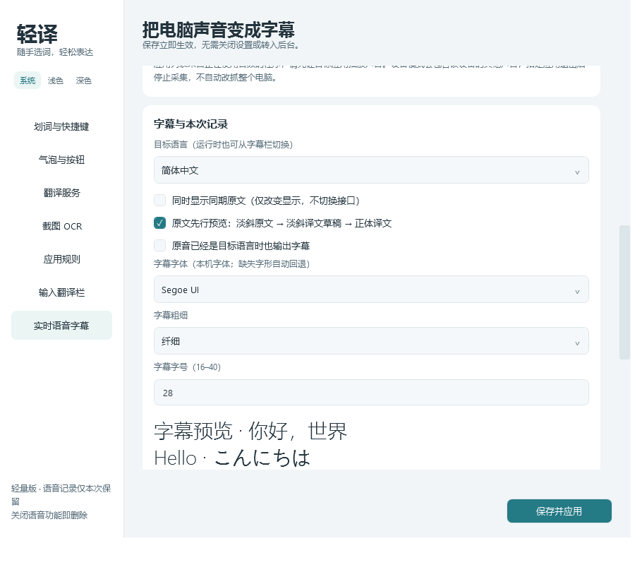
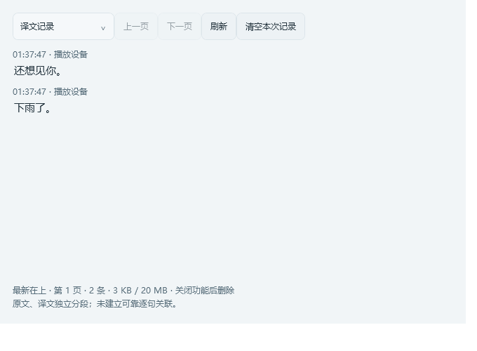

# 实时语音翻译字幕

1.6.0仅使用Gemini Live直译，没有翻译模式选项。分段、展示和保留均在本地处理，不调用第二个文字翻译API；本地开发版的逐句模式配置自动忽略。源语言自动识别，目标语言可切换。不新增本地人声识别模型。首次使用默认显示控制按钮，电影字幕外观默认关闭；已有显隐选择继续保留。

## 首次使用

1. 从旧版托盘选择「退出轻译」，再运行新版。需要.NET 8 Desktop Runtime x64。
2. 设置→实时语音字幕，填写Live接口、模型和密钥，默认模型为`gemini-3.5-live-translate-preview`，也可用同协议网关。
3. 保存并应用。成功后密钥框清空并显示「✓ 密钥已保存」，密钥存Windows凭据管理器；不需要另配文字翻译服务。输入框留空属正常；密钥按接口地址绑定，修改地址后需确认对应地址的保存状态，不会自动删除旧地址的凭据。
4. 选择整个播放设备，或系统支持时的指定应用。先让应用播放声音再刷新，应用重启后需重新选择以免进程号复用。指定应用退出后停止，不自动改抓整个电脑。
5. 按**Ctrl+Alt+S**或从托盘开关整个语音功能，快捷键可自定义。启动应用、保存设置及解除总暂停不会自动采集。

只采集所选电脑播放声音，不用麦克风、不播放译音、不保存录音。

## 字幕规则

- 译文收到就显示，不等待整句完成，不添加慢速打字动画。完整句末优先分段；「下雨了。」等短句独立成立，短促口头词可接后文。
- 接口分片、轮次不强制另起一段。取消每五秒在任意字符处切断；较长内容只在逗号、分号、空白等现有边界形成阅读段，中文无标点时优先等待句末或静音。单段设160–400个UTF-16字符的长度保护（随窗口阅读预算变化），防止异常无限增长；这种保护不等于语言学分句。纯本地规则无法可靠补齐无标点歌词的语义边界。
- 原文先到时以淡斜体预览；译文接替并先显示淡斜草稿，本段首次显示后约0.65秒内转正体，接口已结束时可提前稳定。实际窗口更新以100ms为周期。转正体只是阅读样式，仍可继续接写，不代表整句完成，也不触发消失倒计时。
- 原译可能交错或晚到。只在新的译文段接替原文预览时认领对应原文段，不再屏蔽译文生成期间的所有新原文；下一段原文可以在上一段译文尚未结束时先行显示。已认领原文的后续尾巴只更新原字幕持有的原文，不另起一行；旧临时快照不覆盖新段。
- 原文先到才能先行预览；译文先到时直接显示译文，不倒退为原文。需要同时查看后到的原文，可开启「同时显示同期原文」；这是显示关联，不代表可靠语义逐句对齐。三行译文已满时，原文预览仍不挤走译文。
- 模型仍在返回本轮译文时，播放声音变安静或文字暂时没更新不触发静默收段。逗号、长度等本地软分段先保留显示，等待模型结束后才启动超时；有明确句末标点的完整句仍可正常收段。未结束的长话仍受三行容量与段长度保护。
- 同段多行一起计时：本地收段后完整保留设置的2–15秒，默认5秒，不再把短句偷偷缩短到3秒。尚在接写的段不因转正体提前超时。
- 顶部向下排列，最多三行。接写中的第四行不足4个字符时，先保留前三行，待形成可读片段或定稿后滚动，防止一个新字就挤掉完整旧行。已到期的上一句遇到不足8字符的后句时，接续缓冲最多2秒。容量滚动仍可能早于设定秒数，完整文字进入记录；移出前缀不回来。
- Unicode换行符、连续空白与不可见空白统一为行内文本，折行不生成纯空白行。正斜体共用宽度，不保留空白占位。
- 开启「同时显示同期原文」时最多两行译文加一行原文，原文紧接最后一行译文。仅显示当前字幕持有的原文或新的有效预览，不回填全局最近原文；无法确认时省略原文行。它仅改变显示，不切换接口或调用方式；不保证逐句对应。默认关闭。

## 调整字体

设置→实时语音字幕→字幕与本次记录，可选择本机字体、字号（16–40）和粗细（纤细／常规／中等／半粗／粗体），下方立即预览。默认使用常规字重，旧配置没有这些字段时也使用常规。

点击「保存并应用」直接更新已打开的字幕，不重连、不清空记录；重开窗口、调整透明度或位置均保留字体。原文、草稿和定稿使用相同字体设置；菜单图标不随字幕字体变化。未安装字体或缺失字形回退到系统中文字体，不附带字体包。

## 窗口操作

- 双击文字或空白处显示／隐藏按钮。顶部无整条底板、无标题，仅图标青绿色，按钮和语言选择透明；目标语言文字自动居中、调整宽度。
- 右上角依次为语言、复制、记录、不透明度、明暗切换、收起、锁定、设置、信息、关闭。采集／连接状态和用量点击信息按钮查看，不常驻占字幕行。
- 非按钮、非缩放边缘处可拖动，边缘和角落缩放。位置、尺寸、颜色、不透明度和按钮显隐自动保存；气泡内外观调整不重连。
- 不透明度支持0–100%，滑动即时预览、关闭面板保存。0%隐藏可见背景及边框，无字时有定位条；明暗切换保留不透明度。
- 锁定后穿透鼠标，从托盘解锁。未锁定时有最低非零透明交互层，以便全透明时仍可拖动和双击，锁定后移除。
- 语言切换重建连接并保留记录，切换期间不补传。Esc、×和功能快捷键关闭整个语音功能并清空记录。

## 本次记录与隐私

**最新记录在上方，时间从下往上递增。**第一页显示最新40条，下一页查看更早记录，原文和译文视图一致。停留在第一页顶部时自动更新新记录及当前片段；向下滚动、翻页或选中文字时暂缓自动刷新，避免跳位和打断复制。点击「刷新」返回最新页。

原文、译文各自分段保留，在记录窗口切换查看，不按句子数量强行配对。Live的输入转写独立回传且顺序不保证，当前流没有共用句子编号；翻译也可能合并或拆分句子。因此「两边都能分句」不代表「第N句一定对应第N句」。不标记人物A／B，不伪造确定的逐句关联；需要准确对照须由服务提供可靠关联或另做语义对齐，本版不额外发起请求。两边均能选中，用Ctrl+C／右键复制。

记录只在本次功能开启期间保留，以当前Windows用户DPAPI加密写盘，位置为`%LOCALAPPDATA%\QuietTranslate\LiveHistory`，合计上限20MB，每页最多40条。内存仅保留有限近期字幕、当前段、排版缓存、文件索引和当前页；未变化文字不反复测量。没有定时清理器。

| 操作 | 采集 | 记录 |
|---|---|---|
| 功能快捷键关闭／托盘关闭／Esc／字幕× | 停止 | 删除 |
| 总暂停 | 停止，恢复不自动重开 | 删除 |
| 关闭设置或记录窗口 | 已开启采集继续 | 保留 |
| 清空本次记录 | 继续 | 清空，新内容继续记录；旧前缀不恢复 |
| 退出轻译 | 停止 | 删除 |
| 下次启动 | 默认关闭 | 清理异常退出残留 |

达到20MB后保留已有记录并停止追加，字幕继续。写入、删除失败会提示，删除失败下次启动重试。强退、断电无法即时清理，普通删除不等于不可恢复擦除。系统剪贴板历史、第三方工具和服务商日志由各自管理。

## 接口、费用与限制

支持Gemini Live Translate及同协议兼容网关，不把普通Chat Completions接口当作Live。地址只允许WSS，本机可用WS，不允许把密钥预先写进URL。支持运行时Key查询参数、`x-goog-api-key`和Bearer鉴权，重定向不带密钥跟随。

没有第二次文字翻译请求；Live模型仍可能生成译音，**不播放译音不代表没有音频输出费用**。状态用量是最近一次Live返回值，不是累计账单，实际按模型和账号的平台规则计费。

音频为16kHz单声道16位PCM小分片，最多缓冲约1秒，网络跟不上则停止而非积压。默认设备切换后重连跟随，指定设备断开或指定应用退出时提示。连续失败最多重连三次，断线内容不补传。

真实Gemini账号权限、费用、质量、多人抢话、背景音乐及全部多屏DPI／网络环境未实测。本机模拟协议、合成文本和Windows窗口专项通过，不代表所有模型和网关都支持相同字段。

官方资料：[Live Translate](https://ai.google.dev/gemini-api/docs/live-api/live-translate)、[实时字段](https://ai.google.dev/api/live)、[计费](https://ai.google.dev/gemini-api/docs/pricing)。
